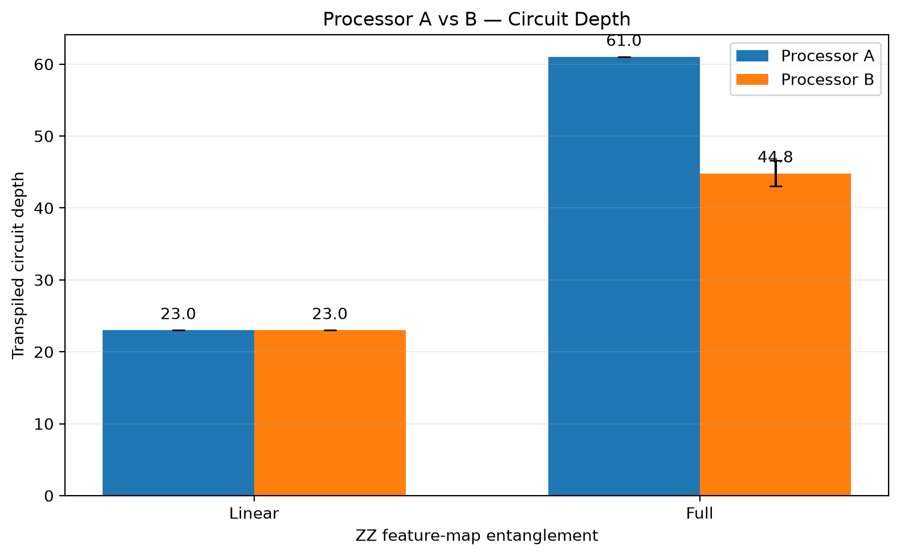
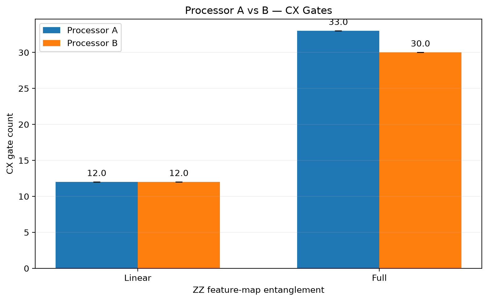

# QFF 2026 — Quantum Kernel Force

## Project Overview
Comparison of quantum kernel support vector machines (QSVM)
with classical RBF and polynomial SVMs using Qiskit.

## Methods
- Datasets: sklearn Digits (0 vs 1) and make_moons
- Quantum feature maps: ZZFeatureMap
- Quantum kernels: fidelity-based, ideal simulation
- Classical baselines: RBF and polynomial SVM
- Model selection: cross-validation
- Repeated experiments: five make_moons seeds
- Processor comparison: Qiskit transpilation for A and B

## Main Results
Five-seed tuned make_moons mean test accuracy:

| Model | Mean Accuracy |
|---|---:|
| Classical RBF SVM | 100.0% |
| Quantum Kernel SVM | 90.4% |
| Classical Polynomial SVM | 87.2% |

No quantum advantage was observed.

## Processor Benchmark
A representative two-qubit fidelity circuit was transpiled
for both supplied processor configurations.

| Processor | Depth | CX Gates | SWAP Gates |
|---|---:|---:|---:|
| A | 27 | 6 | 0 |
| B | 27 | 6 | 0 |

These are compilation metrics, not measured hardware performance.

## Technical Report and Experimental Evidence

The [Phase 1 Technical Report](report.md) explains the PS-Q2
problem statement, methodology, processor architectures,
performance penalties, experimental findings, and limitations.

### Processor Architecture

| Processor A | Processor B |
|---|---|
|  |  |

### Bell-State Validation

A two-qubit Bell state was simulated using 4,096 shots
for each processor configuration.

| Processor A | Processor B |
|---|---|
|  |  |

Both simulations produced 2,009 counts of `00` and
2,087 counts of `11`, consistent with the expected Bell-state
measurement distribution.

These results use ideal simulation, not physical hardware.
The Bell-state experiment can be reproduced using
`generate_bell_evidence.py`.

## Extended Processor Architecture Benchmark

We compared four-qubit ZZ feature-map compilation on both processor
coupling graphs across five transpiler seeds.

| Entanglement | Metric | Processor A | Processor B |
|---|---|---:|---:|
| Linear | Mean depth | 23.00 | 23.00 |
| Linear | Mean CX gates | 12.00 | 12.00 |
| Full | Mean depth | 61.00 | 44.80 |
| Full | Mean CX gates | 33.00 | 30.00 |

For full entanglement, Processor B achieved **26.6% lower mean depth**
and **9.1% fewer CX gates**. Linear entanglement showed no difference.

Reproduce with `benchmark_qml_processors.py` and
`plot_qml_processors.py`. Raw data:
`results/qml_processor_architecture.csv`.

## Noisy Quantum-Kernel Classification Pilot

A separate four-qubit, full-entanglement Digits 0-vs-1 pilot
used 12 training samples, 6 test samples, and 256 shots per circuit.

| Metric | Processor A | Processor B |
|---|---:|---:|
| Ideal test accuracy | 83.33% | 83.33% |
| Noisy test accuracy | 66.67% | 66.67% |
| Mean fidelity-circuit depth | 110.75 | 88.25 |
| Mean CX gates | 63.17 | 55.17 |

Processor B compiled the tested fidelity circuits with **20.3% lower
mean depth** and **12.7% fewer CX gates**, but both processors
achieved identical classification accuracy.

This is a small, finite-shot pilot with illustrative noise,
not a calibrated hardware comparison or statistical advantage claim.

- Script: `benchmark_noisy_qml.py`
- Results: `results/noisy_qml_processor_pilot.csv`
- Detailed methodology and limitations: [Technical Report](report.md)

## Limitations
- Main quantum classification results use ideal simulation; a separate pilot uses illustrative simulated noise.
- Noise pilot uses illustrative noise, not calibrated processor noise.
- Five-seed tuned comparison is limited to make_moons.
- The quantum feature-map design was not independently tuned.
- No physical quantum processor was used.

## Project Files
- `notebooks/main.ipynb`: verified notebook
- `processors/`: processor configurations
- `results/`: experiment tables and plots
- `requirements.txt`: Python dependencies

## Reproduction
Install dependencies from `requirements.txt`, launch Jupyter,
and run `notebooks/main.ipynb` from the first cell.
